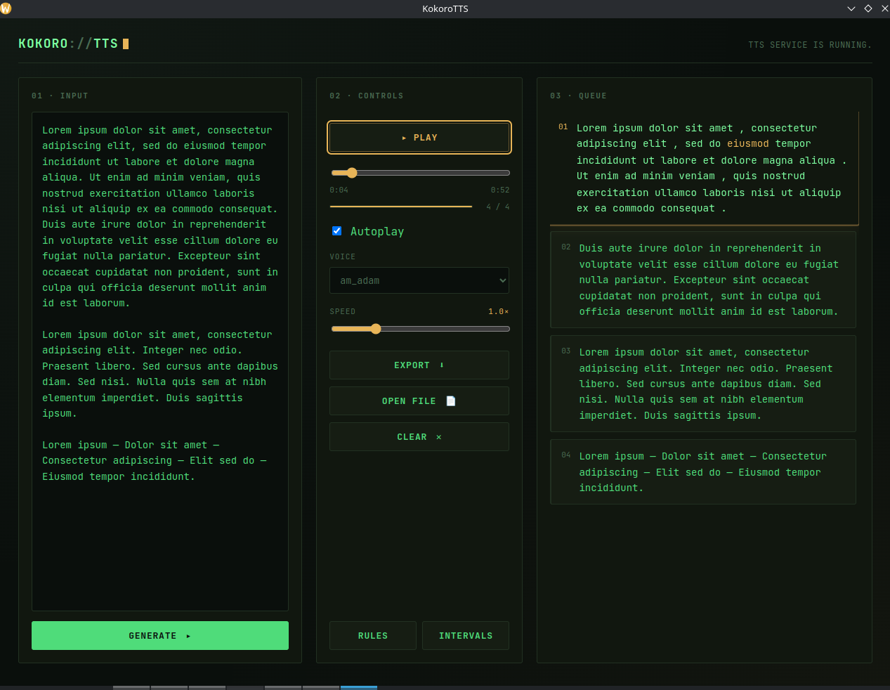

🇵🇱 [Polska wersja](README.pl.md)

# KokoroTTS

A local desktop reader that turns text and documents into speech using the [Kokoro-82M](https://huggingface.co/hexgrad/Kokoro-82M) model — with per-word highlighting as it reads, so you can actually follow along in real time instead of just listening.



## Why

Most TTS readers are either a black-box "read the whole document" button or a cloud API you have to trust with your text. This one talks to a local [Kokoro-FastAPI](https://github.com/remsky/Kokoro-FastAPI) service, reads books and documents chunk by chunk, and shows you exactly which word is being spoken as it plays — closer to a karaoke-style reading aid than a plain audiobook player.

## Features

- **Real-time reading highlight** — as audio plays, the word currently being spoken lights up in a scrolling queue, synced to Kokoro's per-word timestamps. The card always shows your **original text**: Kokoro's normalized tokens (`Doctor` for `Dr.`, `one hundred dollars` for `$100`) are aligned onto it, and the highlight stays on the last word during pauses.
- **Reads documents, not just plain text** — TXT, MD, PDF, DOCX, ODT, RTF, EPUB, MOBI/AZW/AZW3, extracted and cleaned before synthesis.
- **Chunk-by-chunk generation** — text is synthesized one chunk at a time instead of one giant request, so playback starts almost immediately while the rest keeps generating in the background.
- **Text splitting that understands prose** — a custom tokenizer:
  - merges sentences into "speech turns", so a chunk never cuts mid-quote, and keeps dialogue attribution (`"Is that so?" he asked.`) with its line;
  - detects scene breaks (`***`, `###`, `• • •`, `⁂`, `oOo`, a lone dash…) and paragraph breaks and turns them into pauses;
  - automatically unwraps hard-wrapped text (PDF extracts, 80-column .txt files), including hyphenated line breaks;
  - removes spaced dashes and `*emphasis*` markers that would otherwise break Kokoro's timestamps.
- **Resilient generation** — a chunk that fails (Kokoro error, timeout, service stopped mid-run) is retried once, then marked red in the queue and skipped during playback; the UI never gets stuck. Kokoro can be started after the app — the service is checked on every Generate.
- **Configurable Rules** — an in-app popup for regex find/replace rules (e.g. `Qi` → `chi`) applied to the text before it reaches the TTS engine, for names, abbreviations, or units the model mispronounces. Invalid patterns are rejected on save.
- **Configurable Intervals** — another popup controls the pause length between paragraphs and scene breaks, and the max characters per synthesis chunk, so pacing can be tuned per book or voice.
- **MP3 export** — joins every generated chunk, with the same pauses used during playback, into one file via ffmpeg (no re-encoding, correct duration header). Failed chunks are skipped and reported; export also works after a cancelled generation.
- Voice selection and speed control, with the voice list pulled live from the backend.

## Tech stack

Python (pywebview + PyQt6/QtWebEngine) desktop shell · vanilla HTML/CSS/JS frontend (two alternating `<audio>` elements with per-chunk Blob URLs for gapless playback, driven by a single playback state machine) · `pdfplumber` / `python-docx` / `odfpy` / `striprtf` / `ebooklib` for document extraction · `fast-sentence-segment` for sentence boundaries · ffmpeg for silence and export · [Kokoro-FastAPI](https://github.com/remsky/Kokoro-FastAPI) (Docker, CPU or GPU image) running the Kokoro-82M model as the TTS backend.

## Credits

This app is a frontend built on top of [Kokoro-FastAPI](https://github.com/remsky/Kokoro-FastAPI) by remsky — a FastAPI wrapper (Apache 2.0) around the [Kokoro-82M](https://huggingface.co/hexgrad/Kokoro-82M) text-to-speech model. All the actual speech synthesis happens there; this project talks to its API, feeds it documents, and builds the reading/highlighting UI around it.

Thank you to remsky and the Kokoro-FastAPI project — I learned a lot from reading through that codebase while building this one.

## Status

Personal project, actively developed. The core pipeline — document import → chunk-by-chunk generation → gapless playback → real-time word highlight → MP3 export — works end-to-end. In November 2026 the code went through an audit and a round of fixes (tokenizer, backend error handling, playback state machine, highlighting, memory use), now covered by automated tests.

## Running it

Requirements: Python ≥ 3.14 with [uv](https://docs.astral.sh/uv/), Docker, and `ffmpeg` on `PATH` (pauses and MP3 export; without it export still works, but without pauses).

Start the TTS backend (separate service, can be started before or after the app):

```bash
# GPU (NVIDIA)
docker compose up -d
# CPU
docker compose -f docker-compose.cpu.yml up -d
```

Then run the app:

```bash
uv sync
uv run python main.py
```

## Tests

No window and no running Kokoro needed:

```bash
.venv/bin/python _test_tokenizer.py 2>/dev/null   # text splitting: chunks, gaps, quotes, unwrap
node _test_player.mjs                             # playback state machine (fake DOM / audio / bridge)
node _test_highlighter.mjs                        # aligning Kokoro tokens onto the original text
```

Each script prints `ok` / `FAIL` per check and exits non-zero on failure.
