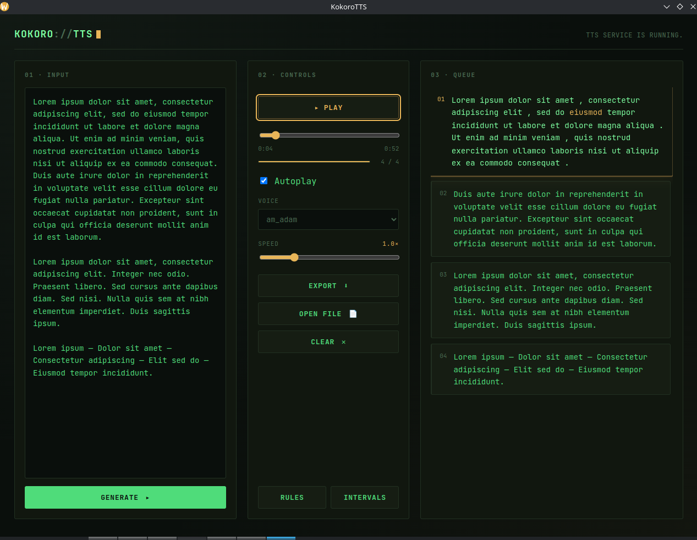

🇬🇧 [English version](README.md)

# KokoroTTS

Lokalny czytnik desktopowy, który zamienia tekst i dokumenty w mowę przy pomocy modelu [Kokoro-82M](https://huggingface.co/hexgrad/Kokoro-82M) — z podświetlaniem słów w czasie rzeczywistym, więc naprawdę widać, gdzie aktualnie jest czytanie, a nie tylko słychać.



## Po co

Większość czytników TTS to albo czarna skrzynka z przyciskiem "przeczytaj cały dokument", albo chmurowe API, któremu trzeba zaufać swój tekst. Ten łączy się z lokalnym serwisem [Kokoro-FastAPI](https://github.com/remsky/Kokoro-FastAPI), czyta książki i dokumenty fragment po fragmencie i pokazuje dokładnie, które słowo jest właśnie wypowiadane — bliżej mu do karaoke niż do zwykłego odtwarzacza audiobooków.

## Funkcje

- **Podświetlanie czytania w czasie rzeczywistym** — podczas odtwarzania aktualnie wypowiadane słowo podświetla się w przewijanej kolejce, zsynchronizowane z timestampami per słowo z Kokoro. Karta zawsze pokazuje **oryginalny tekst**: znormalizowane tokeny Kokoro (`Doctor` dla `Dr.`, `one hundred dollars` dla `$100`) są na niego nakładane, a podświetlenie trzyma się ostatniego słowa w pauzach.
- **Czyta dokumenty, nie tylko czysty tekst** — TXT, MD, PDF, DOCX, ODT, RTF, EPUB, MOBI/AZW/AZW3, tekst jest wyciągany i czyszczony przed syntezą.
- **Generacja fragment po fragmencie** — tekst syntezowany jest kawałek po kawałku zamiast jednego wielkiego requestu, więc odtwarzanie zaczyna się niemal od razu, a reszta generuje się w tle.
- **Dzielenie tekstu, które rozumie prozę** — własny tokenizer:
  - scala zdania w "tury mowy", więc fragment nigdy nie tnie w środku cytatu, a atrybucja dialogu (`"Is that so?" he asked.`) zostaje przy swojej kwestii;
  - rozpoznaje przejścia scen (`***`, `###`, `• • •`, `⁂`, `oOo`, samotny myślnik…) i akapity, i zamienia je na pauzy;
  - automatycznie skleja tekst łamany twardo (wyciągi z PDF, pliki .txt zawijane na 80 kolumn), łącznie z przeniesieniami wyrazów;
  - usuwa myślniki otoczone spacjami i znaczniki `*emfazy*`, które psułyby timestampy Kokoro.
- **Odporna generacja** — nieudany fragment (błąd Kokoro, timeout, serwis zatrzymany w trakcie) jest ponawiany raz, potem oznaczany na czerwono w kolejce i pomijany przy odtwarzaniu; interfejs nigdy się nie zawiesza. Kokoro można uruchomić już po starcie aplikacji — serwis jest sprawdzany przy każdym Generate.
- **Konfigurowalne Reguły** — popup w aplikacji do reguł regex find/replace (np. `Qi` → `chi`) stosowanych na tekście zanim trafi do silnika TTS — dla imion, skrótów czy jednostek, które model źle wymawia. Niepoprawne wzorce są odrzucane przy zapisie.
- **Konfigurowalne Interwały** — kolejny popup steruje długością pauzy między akapitami i scenami oraz maksymalną długością fragmentu syntezy, więc tempo da się dostroić pod konkretną książkę czy głos.
- **Eksport do MP3** — sklejenie wszystkich wygenerowanych fragmentów, z tymi samymi pauzami co przy odtwarzaniu, w jeden plik przez ffmpeg (bez rekodowania, z poprawnym nagłówkiem długości). Nieudane fragmenty są pomijane i zgłaszane; eksport działa też po anulowanej generacji.
- Wybór głosu i prędkości, lista głosów pobierana na żywo z backendu.

## Stos technologiczny

Python (pywebview + PyQt6/QtWebEngine) jako powłoka desktopowa · zwykły HTML/CSS/JS jako frontend (dwa naprzemienne elementy `<audio>` z Blob URL per fragment dla odtwarzania bez przerw, sterowane jedną maszyną stanów odtwarzania) · `pdfplumber` / `python-docx` / `odfpy` / `striprtf` / `ebooklib` do ekstrakcji tekstu z dokumentów · `fast-sentence-segment` do wyznaczania granic zdań · ffmpeg do ciszy i eksportu · [Kokoro-FastAPI](https://github.com/remsky/Kokoro-FastAPI) (Docker, obraz CPU lub GPU) jako backend TTS uruchamiający model Kokoro-82M.

## Podziękowania

Ta aplikacja jest frontendem zbudowanym na bazie [Kokoro-FastAPI](https://github.com/remsky/Kokoro-FastAPI) autorstwa remsky'ego — wrappera FastAPI (Apache 2.0) wokół modelu [Kokoro-82M](https://huggingface.co/hexgrad/Kokoro-82M). Cała właściwa synteza mowy dzieje się tam; ten projekt komunikuje się z jego API, karmi je dokumentami i buduje wokół niego interfejs czytania/podświetlania.

Dziękuję remsky'emu i projektowi Kokoro-FastAPI — dużo się nauczyłem, czytając ten kod podczas budowania własnego.

## Status

Projekt osobisty, aktywnie rozwijany. Główny pipeline — import dokumentu → generacja fragment po fragmencie → odtwarzanie bez przerw → podświetlanie słów w czasie rzeczywistym → eksport MP3 — działa od początku do końca. W listopadzie 2026 kod przeszedł audyt i rundę poprawek (tokenizer, obsługa błędów backendu, maszyna stanów odtwarzania, podświetlanie, zużycie pamięci), teraz pokrytych testami automatycznymi.

## Uruchomienie

Wymagania: Python ≥ 3.14 z [uv](https://docs.astral.sh/uv/), Docker i `ffmpeg` w `PATH` (pauzy i eksport MP3; bez niego eksport działa, ale bez pauz).

Najpierw backend TTS (osobny serwis, można go uruchomić przed aplikacją albo po niej):

```bash
# GPU (NVIDIA)
docker compose up -d
# CPU
docker compose -f docker-compose.cpu.yml up -d
```

Potem sama aplikacja:

```bash
uv sync
uv run python main.py
```

## Testy

Bez okna i bez działającego Kokoro:

```bash
.venv/bin/python _test_tokenizer.py 2>/dev/null   # dzielenie tekstu: fragmenty, pauzy, cudzysłowy, sklejanie linii
node _test_player.mjs                             # maszyna stanów odtwarzania (atrapy DOM / audio / mostu)
node _test_highlighter.mjs                        # nakładanie tokenów Kokoro na oryginalny tekst
```

Każdy skrypt wypisuje `ok` / `FAIL` per sprawdzenie i kończy się kodem ≠ 0 przy błędzie.
